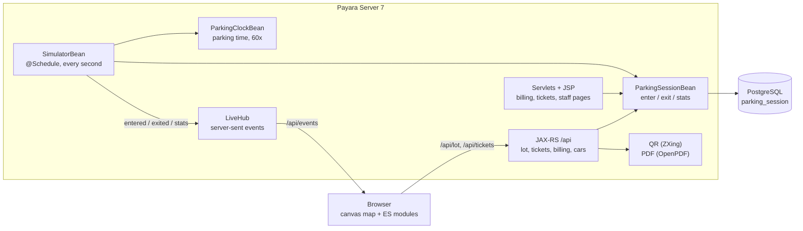

<p align="center">
  
</p>

<p align="center">
  <b>A public parking lot you can watch live, built with plain Jakarta EE.</b><br>
  Pixel-art cars drive in and out in real time, every car gets a ticket with a QR code, and the money ends up in a billing report.
</p>

<p align="center">
  <a href="https://github.com/iosuamagie/parkpulse/actions/workflows/ci.yml"></a>
  
  
  
  
</p>

<!-- Screenshots and the short video go here: docs/images/live.png, ticket.png, billing.png, api-docs.png -->

## Why it exists

ParkPulse started as a lab project for a Jakarta EE course at Lucian Blaga University of Sibiu (ULBS): a CRUD app for cars and users. I kept growing it one step at a time into something you can open and watch, while staying on the course's stack: EJB, JPA, JAX-RS and JSP, with no frontend framework and no JavaScript build step. The map is a 2D canvas driven by plain ES modules, and everything else is rendered on the server.

**Highlights**

- An **EJB timer** runs a traffic simulator on an **accelerated parking clock** (60× real time), so a few minutes on the page show hours of parking and real prices.
- Changes reach every open page over **server-sent events** (JAX-RS SSE), with a heartbeat and automatic reconnect.
- Cars are **drawn in code** as pixel sprites: five shapes, many colours, full routes through the barriers, backing out of the spot, a queue at the gate.
- **Tickets** have unguessable codes, a server-side **QR code** (ZXing, as SVG) and an **80 mm PDF receipt** (OpenPDF, with Romanian letters).
- A **billing page** and an A4 **PDF report**, behind role-based security (Jakarta Security, PBKDF2 hashes, CSRF tokens).
- The API is described with **MicroProfile OpenAPI** and browsable in **Swagger UI**.
- **Integration tests** start the real app in Docker with Testcontainers and use it like a browser and an API client; GitHub Actions runs them on every push.

## What you see

- **The live lot** (`/`, public): 24 spots with numbers painted on the asphalt, three spots for people with disabilities, and cars of five shapes and many colours. Each car drives the whole way: through the entry barrier, along the aisle and into its spot. When it leaves, it backs out and goes through the exit barrier. Cards on the left show free spots, today's money, cars today and the average stay; the right column lists the latest entries and exits. Updates arrive over server-sent events.
- **The ticket**: click a car or a line of the activity list and the ticket grows out of it. Its QR code "prints" row by row, and the amount due keeps climbing while the car is parked. The QR code opens the ticket on its own page (`/bilet/{code}`), made for phones. After the car leaves, the ticket offers a PDF receipt, 80 mm wide like a till receipt.
- **Billing** (`/billing`, role `INVOICING`): money per period with a bar for each day, the paid tickets with search and pages, and a PDF report for any period of up to 366 days.
- **API docs** (`/api-docs`, public): Swagger UI on the OpenAPI document that Payara builds from the annotations (`/openapi`).
- **Subscriptions and users** (staff, `/Cars` and `/Users`): cars with a reserved spot, an owner and a photo, kept apart from the simulated cars on the map, and the users with their roles.

The parking lot has its own clock that runs 60 times faster than real time, so a few minutes on the page show the stays and prices of a few hours. The tariff is 15 free minutes, then 6 lei per hour, charged for every started minute.

Ticket codes are 22 random characters, so nobody can guess another person's ticket. Because the cars are simulated, the live map shares their codes with everyone; a real lot would only print them on the paper ticket.

## How it works



Each simulator step commits its own transaction before the event goes out, so a page that receives an event can always load the matching ticket. When a tab comes back from the background, the page redraws the lot from a fresh snapshot instead of replaying the moves it missed.

## Run it in one command

You only need [Docker](https://www.docker.com/products/docker-desktop/).

```
docker compose up --build
```

The first start downloads Payara and PostgreSQL and takes a few minutes; later starts take about 30 seconds. Then open http://localhost:8080. On an empty database the app creates 30 days of parking history and a dozen parked cars, so every page has something to show right away.

The staff pages need a login. All demo users have the password `parkpulse-demo`:

| User | What they can do |
|---|---|
| `admin` | everything |
| `viewer` | see cars and users |
| `billing` | see cars and users, and the billing page with its PDF report |

If port 8080 is taken, pick another one: `PARKPULSE_PORT=8081 docker compose up --build`.

The demo passwords are for your own computer only. Before putting the app anywhere public, set `PARKPULSE_DB_PASSWORD` and `PARKPULSE_DEMO_PASSWORD` in a `.env` file (it is ignored by git), or turn the demo data off with `PARKPULSE_DEMO_DATA=false`.

To start again from an empty database: `docker compose down -v`.

### Settings

| Variable | Default | What it does |
|---|---|---|
| `PARKPULSE_SIMULATOR` | `true` in Docker Compose | Lets simulated cars enter and leave |
| `PARKPULSE_CLOCK_SPEED` | `60` | How many times faster than real time the parking clock runs |
| `PARKPULSE_PUBLIC_URL` | empty | The address put in the ticket QR codes, for example `https://parkpulse.example.com`; empty means the address the page was opened with |
| `PARKPULSE_DEMO_DATA` | `true` in Docker Compose | Creates the demo users, cars and parking history on an empty database |
| `PARKPULSE_PORT` | `8080` | The port on your computer |

## Stack

Java 21, Jakarta EE 10 (Servlets, JSP with JSTL, EJB with timers, CDI, JPA, JAX-RS with server-sent events, JSON-B, Jakarta Security), MicroProfile OpenAPI, Gradle, running on Payara Server 7 with PostgreSQL 17. QR codes come from ZXing, PDFs from OpenPDF, and the map is plain JavaScript modules on a 2D canvas.

```
src/main/java/org/example/parkinglot
  parking/    the tariff, the parking clock, the spots and the simulator's decisions (plain Java, unit tested)
  entities/   JPA entities: ParkingSession, Car, CarPhoto, User, UserGroup
  ejb/        business logic, the traffic simulator, billing, the data source and the demo data
  live/       the hub that sends lot changes to every open page
  documents/  the QR code, the receipt and the billing report
  rest/       JAX-RS API under /api
  servlets/   pages: tickets, billing, API docs, cars, users and login
  security/   login setup and the CSRF filter
  common/     DTOs passed to the pages and the API
src/main/webapp
  WEB-INF/pages   JSP views
  scripts/        the live map, the ticket and the API docs page (ES modules, no build step)
  styles/app.css  the look of every page
```

## Without Docker

1. Build the WAR file with `./gradlew war`.
2. Deploy `build/libs/parkpulse.war` on a Jakarta EE 10 or 11 server with MicroProfile OpenAPI (tested on Payara 7) with these environment variables: `PARKPULSE_DB_URL` (for example `jdbc:postgresql://localhost:5432/parkpulse`), `PARKPULSE_DB_USER` and `PARKPULSE_DB_PASSWORD`, plus any of the settings above. The PostgreSQL driver is inside the WAR, JPA creates the tables, and the login needs no server setup.

## Tests

- `./gradlew test` runs the unit tests: the tariff, the parking clock, the spots, ticket codes, plates, the simulator's choices, billing periods, the QR code, and the text of the receipt and the report read back from the PDFs. No Docker needed.
- `./gradlew integrationTest` starts the real app with [Testcontainers](https://testcontainers.com/): Payara and PostgreSQL in Docker, with the freshly built WAR. The tests then use it like a browser and like an API client: the public lot and its live feed, tickets and bad ticket codes, receipts for parked and departed cars, the billing page and its bad dates, the OpenAPI document, logins as each demo user, pages they are not allowed to see, forms without a CSRF token, fake and oversized images, and escaped user text.

GitHub Actions runs both on every push (`.github/workflows/ci.yml`).
